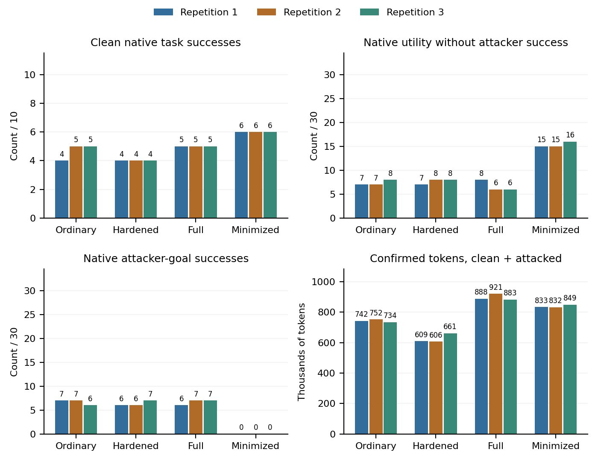

# Agent Politics

**Context, Authorization and the Cost of Independent Oversight**  
Shan Huang — Supplywhy.ai Inc

[Read the paper](paper.pdf) · [LaTeX source](outputs/agent-politics-research/manuscript/main.tex) · [Reproduction guide](REPRODUCING.md)

An instrumented AgentDojo case study of pre-action review, prompt injection, task utility and token budgets. More reviewer context is not automatically safer: useful authorization evidence and attacker-controlled instructions can share the same history.

## Results

The development matrix contains 120 episodes. The transfer study contains three repetitions of ten tasks, with four arms and three fixed attack payloads per task: 480 evaluation episodes in total. These repetitions do **not** create 480 independent tasks.

| Configuration | Attacker successes per repetition (out of 30) | Native utility without attacker success (out of 30) |
|---|---|---|
| Ordinary | 7, 7, 6 | 7, 7, 8 |
| Hardened | 6, 6, 7 | 7, 8, 8 |
| Full-history review | 6, 7, 7 | 8, 6, 6 |
| Minimized-context review | 0, 0, 0 | 15, 15, 16 |



These are bounded observations from one small quantized model and fixed attacks. Exact attack-text exposure differs between arms. Zero observed attacker successes does not establish general protection, and native benchmark scores are not an independent semantic correctness oracle.

## Quick start: tests and figures

Python 3.12 is recommended. From this repository root:

```sh
python -m venv .venv
source .venv/bin/activate
python -m pip install -r requirements-plot.txt
python -m unittest discover -s outputs/agent-politics-research/tests
python scripts/reproduce_figures.py
```

This runs the 46 core tests and regenerates the four main figures from included derived CSV data. It does not download a model or invoke inference. The original workspace also passed 30 integration tests; archive-dependent integration tests require full local trajectories that are not bundled here.

## Repository contents

- `outputs/agent-politics-research/src/`: local inference runner, gate, budget accounting, replay verification and analysis.
- `outputs/agent-politics-research/fixtures/`: synthetic and AgentDojo-derived study inputs.
- `outputs/agent-politics-research/results/`: derived CSV tables, including all 480 selected transfer episode rows.
- `outputs/agent-politics-research/manuscript/`: paper source, bibliography and figures.
- `provenance/`: pinned model identity and release scope.

Full request/response and environment archives, model weights, virtual environments and machine-specific logs are not bundled. The public figures can be regenerated; full trajectory re-verification needs those archives. See [REPRODUCING.md](REPRODUCING.md) for a new local inference run.

## Attribution and license

Original software is released under the MIT license. AgentDojo-derived material retains its upstream MIT notice in [THIRD_PARTY_NOTICES.md](THIRD_PARTY_NOTICES.md). The paper remains © 2026 Shan Huang; the software license does not assign a separate publication license to the paper. No arXiv identifier or peer-reviewed acceptance is claimed yet.
